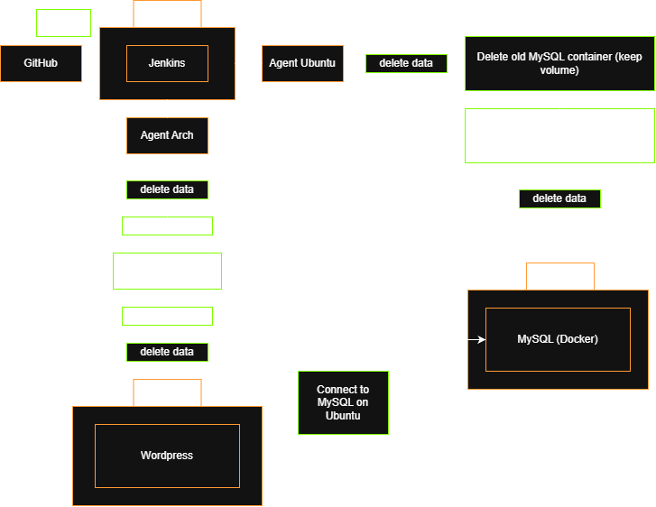

# Overview

## Pipeline Diagram

  

## Task

1. Configure pipeline according to the diagram
2. Ensure that Jenkins clear agent's folder before and after pipeline
3. Prepare documentation with project description and guide how to run it
4. Store .env_example in repository to show which environment variables required
5. Use Jenkins environment variables to paste them into wordpress configuration

